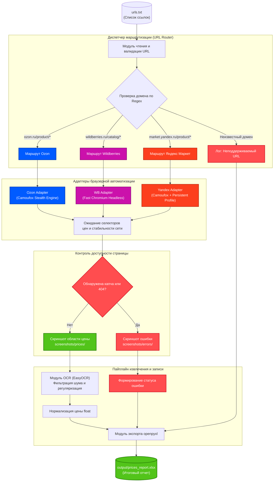

# ТЗ: Мультиплатформенный парсер цен (Ozon, Wildberries, Яндекс Маркет)

## 1. Назначение и цель проекта

Разработка консольного Python-приложения для пакетной обработки ссылок на карточки товаров трех маркетплейсов: Ozon, Wildberries и Яндекс Маркет.

Приложение читает ссылки из текстового файла, определяет целевой маркетплейс, загружает страницу через специализированный адаптер браузера, делает снимок области с ценой, распознает числовое значение с помощью OCR и сохраняет структурированный отчет в файл Excel (.xlsx).

## 2. Архитектура и схема маршрутизации



## 3. Специфика адаптеров и стратегии обхода защит

### 3.1. Wildberries
- Шаблон URL: `https://www.wildberries.ru/catalog/{id}/detail.aspx`
- Защита: базовая.
- Стратегия: быстрый запуск через стандартный headless Chromium с эмуляцией мобильного экрана (Mobile Viewport 390x844), где блок с ценой и названием всегда располагается на первом экране.

### 3.2. Ozon
- Шаблон URL: `https://www.ozon.ru/product/{id}/`
- Защита: строгий антибот (детект Chrome DevTools Protocol, проверка флагов автоматизации, выдача страницы «404 / Не найдено»).
- Стратегия: запуск через stealth-движок **Camoufox** (Firefox C++ fork) с генерацией реалистичных отпечатков WebGL/Canvas и случайной паузой в 3–6 секунд перед переходом.

### 3.3. Яндекс Маркет
- Шаблон URL: `https://market.yandex.ru/product/{id}`
- Защита: периодическая SmartCaptcha.
- Стратегия: использование Camoufox с сохранением постоянного пользовательского профиля (`user_data_dir`) для накопления валидных куки сессии.

## 4. Функциональные требования к компонентам

### 4.1. Модуль чтения и валидации (`src/router.py`)
- Источник: текстовый файл `urls.txt` в корне проекта.
- Обработка строк: удаление пробелов, фильтрация пустых строк и строк с комментариями `#`.
- Определение платформы: регулярные выражения по доменам (`ozon`, `wildberries`, `market.yandex`).

### 4.2. Модуль браузерной автоматизации (`src/browser_worker.py`)
- Изолированные контексты под каждый запрос.
- Ожидание загрузки ключевых селекторов цен с таймаутом в 15 секунд.
- Создание снимка экрана:
  - При успехе: кроп целевого блока цены в файл `screenshots/prices/{market}_{id}_{timestamp}.png`.
  - При ошибке / капче: снимок экрана в файл `screenshots/errors/{market}_{id}_{timestamp}.png`.

### 4.3. Модуль оптического распознавания (`src/ocr_worker.py`)
- Библиотека: `easyocr` (языки: русский, английский).
- Предобработка: перевод изображения в градации серого и увеличение контраста при слабой читаемости.
- Фильтрация регулярными выражениями: поиск последовательностей цифр с удалением неразрывных пробелов и знаков валют (`₽`, `руб.`, `BYN`).
- Приведение результата к типу `float`.

### 4.4. Модуль формирования отчета (`src/excel_worker.py`)
- Файл отчета: `output/prices_report_<ГГГГ-ММ-ДД>.xlsx`.
- Структура столбцов таблицы:
  1. `A: №` (порядковый номер)
  2. `B: Маркетплейс` (Ozon, Wildberries, Yandex Market)
  3. `C: Исходная ссылка` (активная гиперссылка)
  4. `D: Цена (число)` (числовой формат для возможности автосуммирования)
  5. `E: Валюта` (RUB)
  6. `F: Статус` (`SUCCESS`, `CAPTCHA_BLOCKED`, `NOT_FOUND`, `UNSUPPORTED_URL`)
  7. `G: Скриншот` (гиперссылка на локальный файл изображения)
  8. `H: Дата и время проверки`
- Автосохранение книги каждые 5 обработанных ссылок во избежание потери данных при сбоях.

## 5. Поведенческие сценарии (OpenSpec / BDD)

### Сценарий 1: Успешное распознавание цены товара
- **GIVEN** валидная ссылка на карточку товара из `urls.txt`.
- **WHEN** соответствующий адаптер открывает страницу и подтверждает отсутствие капчи.
- **THEN** скрипт делает снимок блока с ценой.
- **AND** модуль OCR извлекает корректное числовое значение.
- **AND** строка добавляется в Excel со статусом `SUCCESS`.

### Сценарий 2: Срабатывание защиты маркетплейса
- **GIVEN** ссылка на карточку Ozon или Яндекс Маркета.
- **WHEN** на странице появляется защитный экран капчи или 404.
- **THEN** программа сохраняет диагностический скриншот в папку `screenshots/errors/`.
- **AND** в файл Excel заносится статус `CAPTCHA_BLOCKED`.
- **AND** выполнение продолжается со следующей ссылки без остановки программы.

## 6. Структура каталогов проекта

```text
Cards-reader/
├── openspec/
│   └── specs/
│       └── market_price_scanner.md  # Настоящее ТЗ
├── output/                          # Итоговые файлы Excel
├── screenshots/
│   ├── prices/                      # Снимки цен для валидации
│   └── errors/                      # Снимки ошибок и капчи
├── src/
│   ├── config.py                    # Настройки путей, таймаутов, User-Agent
│   ├── main.py                      # Точка входа и диспетчер пайплайна
│   ├── router.py                    # Парсинг и классификация URL
│   ├── browser_worker.py            # Управление браузерами (Camoufox / Playwright)
│   ├── ocr_worker.py                # Распознавание изображений и очистка цен
│   └── excel_worker.py              # Запись данных и форматирование .xlsx
├── requirements.txt                 # Зависимости проекта
└── urls.txt                         # Входной список ссылок
```

## 7. Чек-лист реализации (Tasks)

- [x] 1. Создать структуру каталогов (`src/`, `output/`, `screenshots/prices/`, `screenshots/errors/`) и файл `urls.txt`.
- [x] 2. Сформировать `requirements.txt` (`camoufox`, `playwright`, `easyocr`, `openpyxl`, `loguru`) и установить пакеты.
- [x] 3. Реализовать `src/router.py`: логика разделения ссылок по регулярным выражениям.
- [x] 4. Реализовать базовый адаптер Camoufox в `src/browser_worker.py` с сохранением скриншотов.
- [x] 5. Реализовать модуль `src/ocr_worker.py` с парсингом числовых значений цен.
- [x] 6. Реализовать модуль `src/excel_worker.py` с созданием колонок и гиперссылок.
- [x] 7. Собрать единый конвейер в `src/main.py` с логированием через `loguru`.
- [x] 8. Выполнить тестовый прогон по 2 тестовым ссылкам каждого маркетплейса.